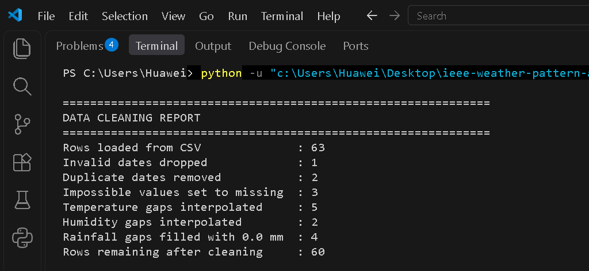
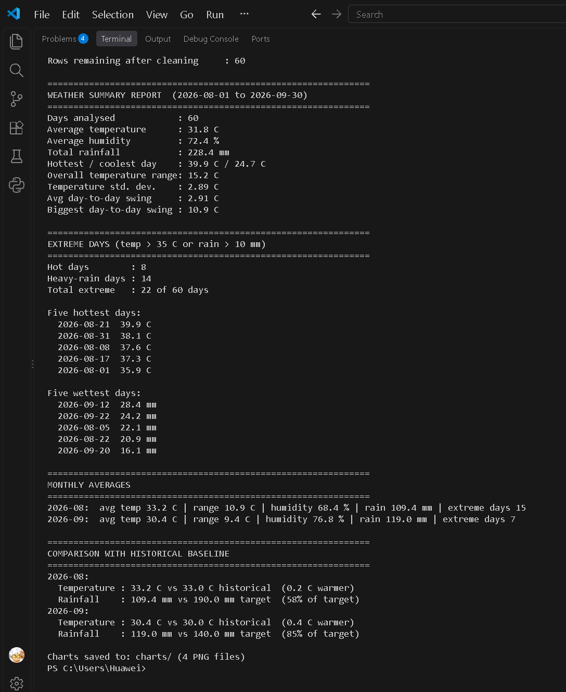
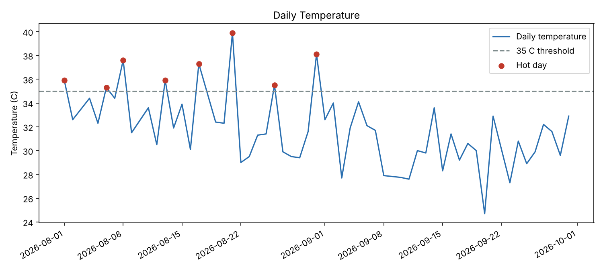
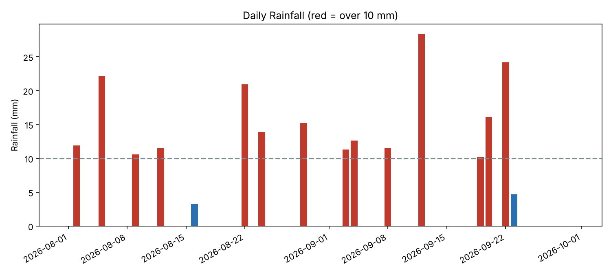
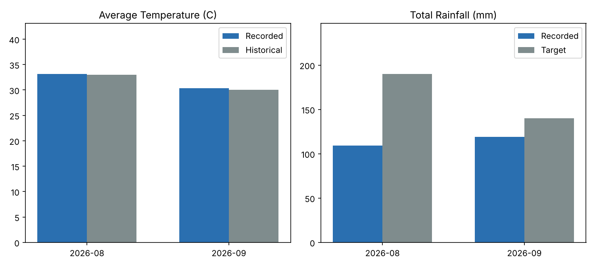
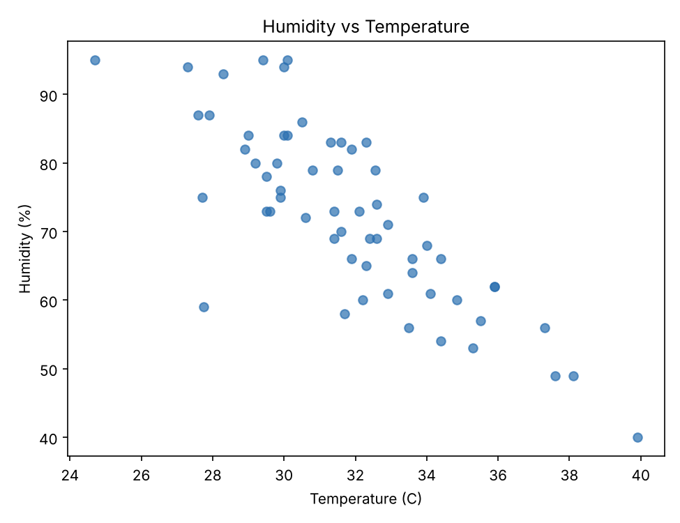

# Weather Pattern Analyzer
### IEEE LGU AI/ML Cohort One — Fall 2026
**Week 3 Assignment:** Data Analysis with NumPy & Pandas
**AI/ML Leads:** Abdullah Faisal & Alina Irshad

---

## 1. Project Overview
A weather station recorded daily temperature, humidity and rainfall for August and September 2026, but some readings are missing, duplicated or impossible because of sensor errors. This program parses and cleans the readings, calculates temperature and rainfall statistics with NumPy, groups them by month, and merges the monthly results with a second CSV of historical baselines. The report shows extreme weather days, monthly averages, and how the recorded weather compares with the historical baseline.

## 2. Key Concepts Implemented
- [x] Pandas DataFrame Loading & Cleaning (`read_csv`, `fillna`, `dropna`, `drop_duplicates`)
- [x] NumPy Statistical Calculations (Mean, Median, Standard Deviation, Sums)
- [x] Data Grouping & Aggregation (`groupby`)
- [x] Conditional Filtering & Indexing
- [x] Dataset Merging / Time-Series Resampling (monthly summary merged with `monthly_targets.csv`)

## 3. How to Run the Program

```shell
pip install -r requirements.txt
python main.py
```

The script prints the cleaning report and the weather summary to the terminal, and saves four PNG charts into the `charts/` folder.

## 4. Dataset Information & Cleaning Decisions
* **Data Source:** Both CSV files are synthetic datasets I constructed for this assignment. `data/daily_weather.csv` has 63 raw rows (daily readings for 1 Aug – 30 Sep 2026, shaped like hot, humid monsoon-season weather) and `data/monthly_targets.csv` holds the historical average temperature and target rainfall per month. They are not real station records. Sensor errors were added on purpose so the cleaning steps have something to fix.
* **All data is read from the CSVs** with `pandas.read_csv()`. No records are hardcoded in `main.py`.

**Cleaning decisions:**

| Problem | Rows | Decision | Why |
|---|---|---|---|
| Impossible date (`2026-13-45`) | 1 | Dropped | The reading cannot be placed on a day. That day is now missing from the series, and the neighbouring days are used when filling gaps |
| Duplicate dates | 2 | Dropped, first copy kept | One reading per day, so no day is counted twice |
| Non-numeric text (`abc`, `N/A`) | 3 | Converted to missing, then handled as below | Text cannot be used in calculations |
| Impossible values: temperature `99.9` C, humidity `140` %, rainfall `-4` mm | 3 | Set to missing, then handled as below | These are sensor faults, not real weather |
| Missing temperature (5 gaps) and humidity (2 gaps) | 7 | Linear interpolation between neighbouring days | Temperature and humidity change gradually, so the in-between value is a reasonable estimate |
| Missing rainfall (4 gaps) | 4 | Filled with `0.0` mm | Rain is sporadic, so interpolating would invent rainfall. This assumes a missing reading means no rain, which may slightly understate rainfall |

Result: 63 rows loaded → 60 clean days.

**Definitions used:** a *hot day* is above 35 °C, a *heavy-rain day* is above 10 mm, and an *extreme day* is either. The dataset has one temperature reading per day, so the "temperature range" is calculated two ways: the monthly range (max − min) and the day-to-day swing (`np.diff`).

## 5. Console Output Screenshots
Cleaning report:



Summary report:



## 6. Charts (optional)
| | |
|---|---|
|  |  |
|  |  |

## 7. Project Structure
```
ieee-weather-pattern-analyzer/
├── README.md
├── main.py
├── requirements.txt
├── data/
│   ├── daily_weather.csv
│   └── monthly_targets.csv
├── charts/
└── screenshots/
```
